# Free Prop Firm Landing Page Templates (React + Tailwind CSS)

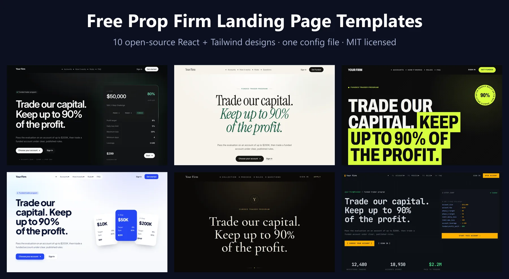

**10 free, open-source website templates for prop trading firms.** Each one is a complete prop firm landing page with challenge pricing, an account picker, a phase-by-phase rules table, a "how it works" section and an FAQ, all generated from one config file. Built with React 19, Tailwind CSS and Vite. MIT licensed, free for commercial use.

[**Live demo**](https://propsim-enterprise.github.io/prop-firm-landing-page-templates/) · [**Quick start**](#quick-start) · [**Make it yours**](#make-it-yours) · [**PropSim prop firm software**](https://propsim.markets/?utm_source=github&utm_medium=readme&utm_campaign=prop-firm-landing-page-templates)

[](LICENSE)
[](https://propsim-enterprise.github.io/prop-firm-landing-page-templates/)


These are the same storefront designs that firms launch with on [PropSim](https://propsim.markets/?utm_source=github&utm_medium=readme&utm_campaign=prop-firm-landing-page-templates), the software that runs prop firms. Here they run on their own, with your data, on any host.

## The templates

| | |
|---|---|
| [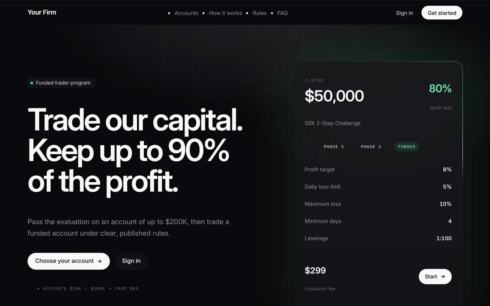](https://propsim-enterprise.github.io/prop-firm-landing-page-templates/templates/onyx/)<br>**[Onyx](https://propsim-enterprise.github.io/prop-firm-landing-page-templates/templates/onyx/)** · dark, minimal, data-led | [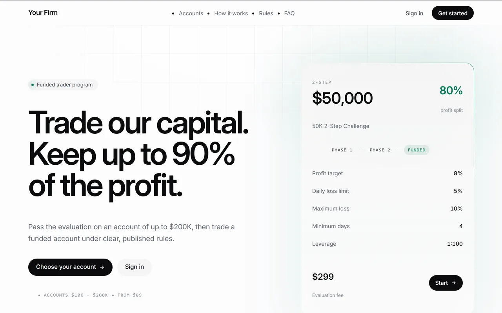](https://propsim-enterprise.github.io/prop-firm-landing-page-templates/templates/onyx-light/)<br>**[Onyx Light](https://propsim-enterprise.github.io/prop-firm-landing-page-templates/templates/onyx-light/)** · light, minimal, data-led |
| [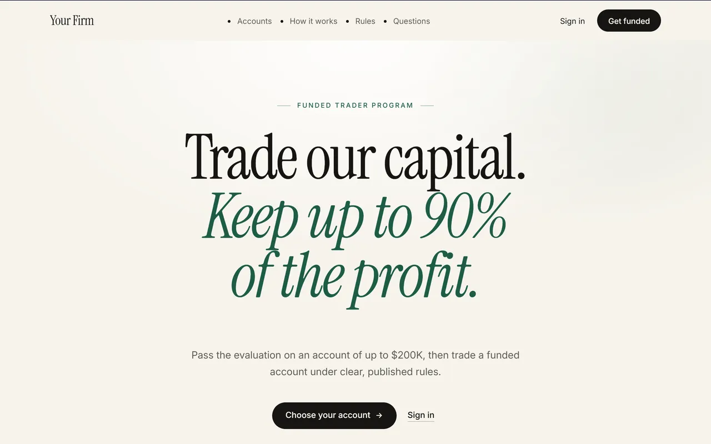](https://propsim-enterprise.github.io/prop-firm-landing-page-templates/templates/ivory/)<br>**[Ivory](https://propsim-enterprise.github.io/prop-firm-landing-page-templates/templates/ivory/)** · light, editorial, serif | [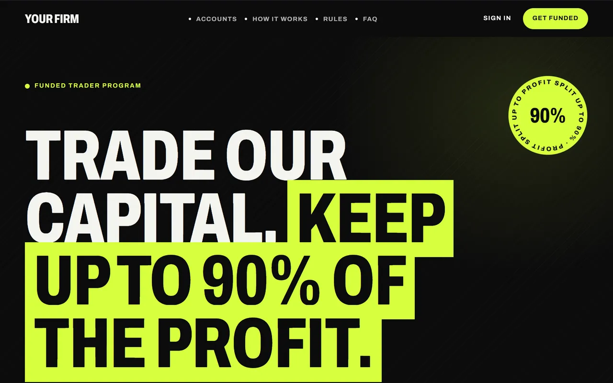](https://propsim-enterprise.github.io/prop-firm-landing-page-templates/templates/volt/)<br>**[Volt](https://propsim-enterprise.github.io/prop-firm-landing-page-templates/templates/volt/)** · dark, bold, high-energy |
| [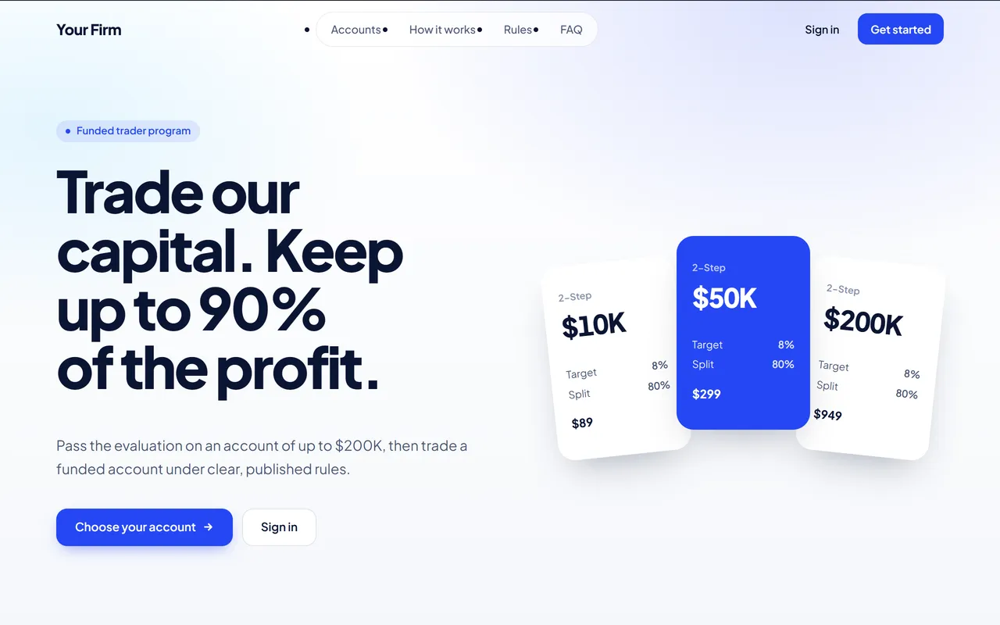](https://propsim-enterprise.github.io/prop-firm-landing-page-templates/templates/cobalt/)<br>**[Cobalt](https://propsim-enterprise.github.io/prop-firm-landing-page-templates/templates/cobalt/)** · light, bold, friendly | [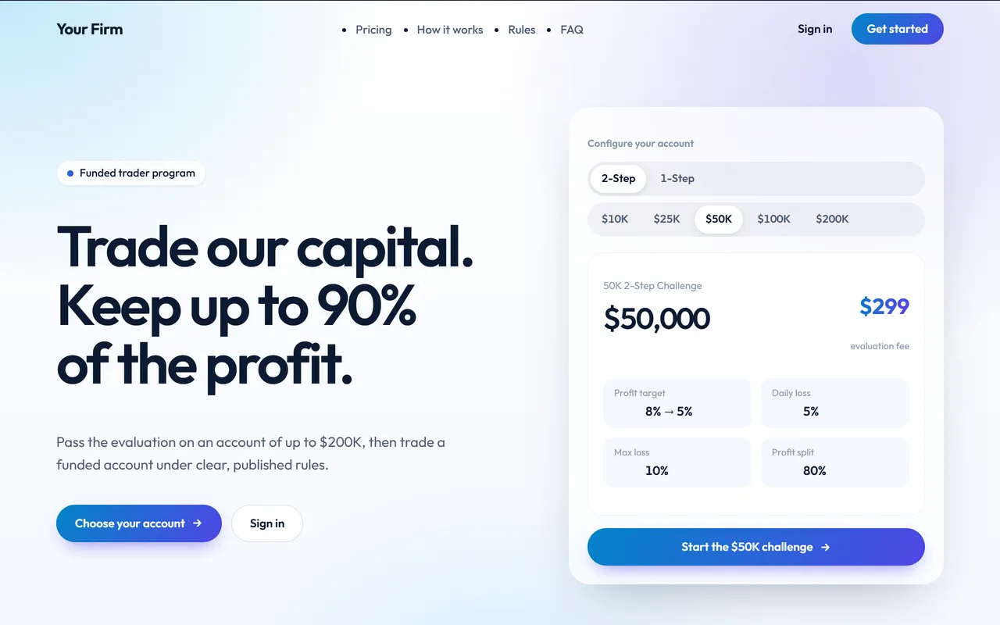](https://propsim-enterprise.github.io/prop-firm-landing-page-templates/templates/azure/)<br>**[Azure](https://propsim-enterprise.github.io/prop-firm-landing-page-templates/templates/azure/)** · light, friendly, gradient |
| [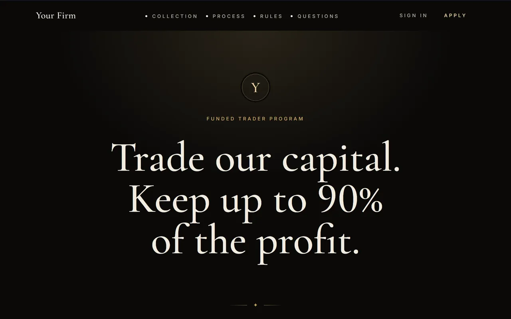](https://propsim-enterprise.github.io/prop-firm-landing-page-templates/templates/aurum/)<br>**[Aurum](https://propsim-enterprise.github.io/prop-firm-landing-page-templates/templates/aurum/)** · dark, luxury, serif | [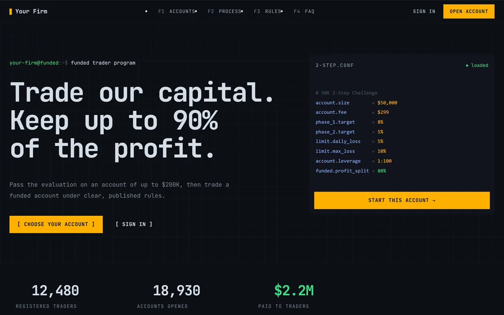](https://propsim-enterprise.github.io/prop-firm-landing-page-templates/templates/quant/)<br>**[Quant](https://propsim-enterprise.github.io/prop-firm-landing-page-templates/templates/quant/)** · dark, trading terminal, data-dense |
| [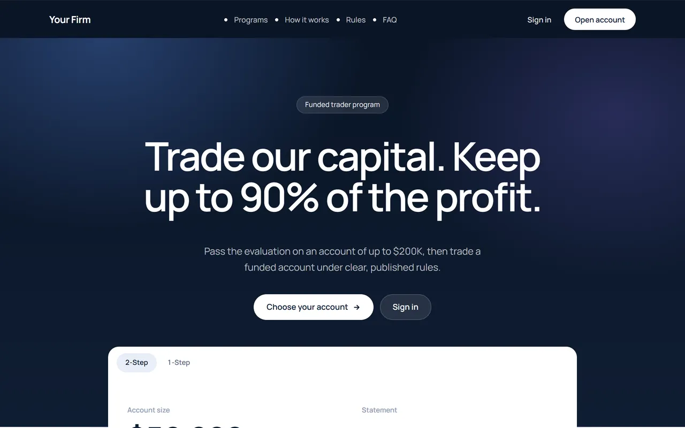](https://propsim-enterprise.github.io/prop-firm-landing-page-templates/templates/harbor/)<br>**[Harbor](https://propsim-enterprise.github.io/prop-firm-landing-page-templates/templates/harbor/)** · light, calm, banking | [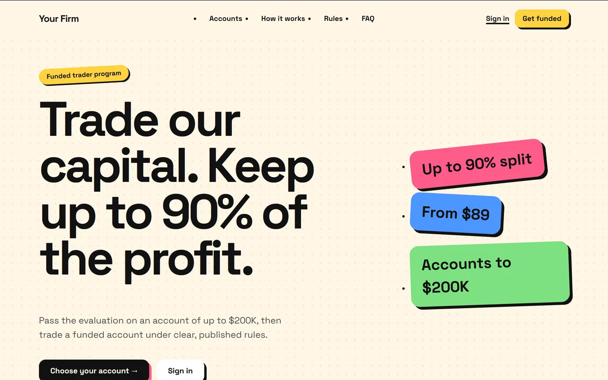](https://propsim-enterprise.github.io/prop-firm-landing-page-templates/templates/pop/)<br>**[Pop](https://propsim-enterprise.github.io/prop-firm-landing-page-templates/templates/pop/)** · light, playful, neo-brutalist |

## What every template includes

- **Challenge pricing and an account picker.** Programs (2-Step, 1-Step or any you define) as tabs, every account size with its evaluation fee, and a "start challenge" button for each account.
- **Rules, phase by phase.** Profit target, daily loss limit, maximum or trailing drawdown, minimum trading days, leverage and profit split for every phase up to the funded account.
- **"How it works" and an FAQ that write themselves** from your challenges. Add your own questions on top.
- **Stats and testimonials, only when they are real.** A section with nothing to show is hidden, never filled with placeholders.
- **Built for phones.** A phone menu, 44 px tap targets, text of at least 12 px, and layouts checked at 360 px and 414 px.
- **One config file.** Every template reads `site/config.ts`, so you can switch designs without touching your data.
- **SEO-ready static pages.** Each page has its own title, description, canonical URL and Open Graph image, and the build is plain HTML, CSS and JavaScript.

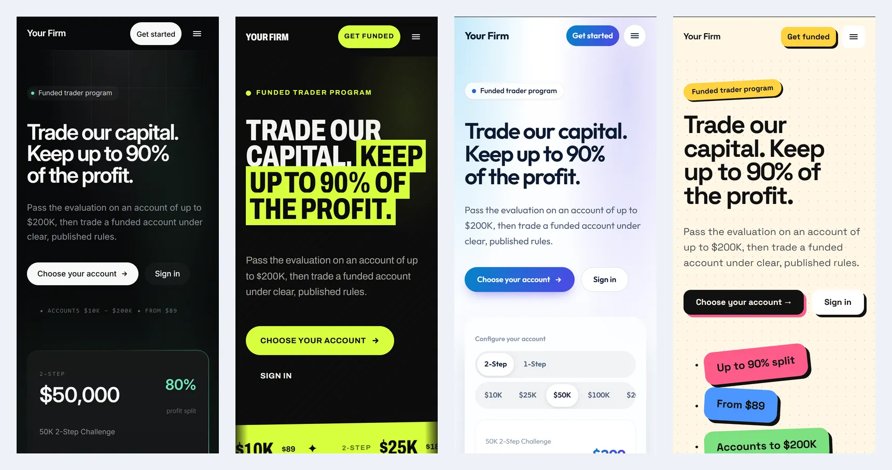

## Quick start

You need Node.js 20 or newer.

```bash
git clone https://github.com/PropSim-Enterprise/prop-firm-landing-page-templates.git
cd prop-firm-landing-page-templates
npm install
npm run dev
```

Open the address Vite prints. The gallery lists every template, and each one runs with sample challenges. You can also click **Use this template** on GitHub to start your own copy.

## Make it yours

Everything you change lives in two files.

**`site/config.ts`**, in five parts:

1. **`DEMO_MODE`.** Leave it `true` while you try designs: it shows the template switcher and explains each button. Set it to `false` before you go live.
2. **`FIRM`.** Your firm name, logo (`logoUrl`, or separate `logoUrlDark` and `logoUrlLight`), social links, the legal pages to list in the footer, and your stats. The sample stats are made up: replace them with real figures or delete them to hide the section.
3. **`PRODUCTS`.** Your challenges. The sample builds a 2-Step and a 1-Step program; change sizes, prices, targets and splits, or add programs. The group name becomes the program tab. Supported rule codes: `PROFIT_TARGET`, `MAX_DAILY_LOSS`, `MAX_OVERALL_LOSS`, `TRAILING_DRAWDOWN`, `MIN_TRADING_DAYS` and `MAX_TRADING_DAYS`.
4. **`STOREFRONT`.** Hero text (leave a field empty to use a default written from your challenges), an about section, an announcement bar, extra FAQ entries and real testimonials.
5. **`LINKS`.** Where "Start challenge", "Sign in" and the footer legal links go: your checkout, your trader dashboard and your legal pages.

**`src/core/disclaimer.tsx`** holds the footer disclaimer. It is a neutral starting point for a firm that sells simulated evaluations, **not legal advice**: replace it with wording your lawyer has reviewed. The same file has an optional one-line credit you can switch off.

With `DEMO_MODE = false`, each page titles itself after your firm. Also edit the `<title>`, description and Open Graph tags in the HTML page you deploy, since those are what search engines and link previews read first.

To pick a template for your site, deploy and link to its page (for example `/templates/onyx/`), or make it your home page by copying `templates/onyx/index.html` over `index.html` and fixing the relative paths.

## Deploy

```bash
npm run build   # type-checks, then writes the site to dist/
```

`dist/` is a static site. Upload it anywhere:

- **GitHub Pages:** the included workflow (`.github/workflows/deploy.yml`) builds and publishes on every push to `main`. In your repository, open Settings, then Pages, and set the source to **GitHub Actions**.
- **Netlify, Vercel or Cloudflare Pages:** build command `npm run build`, output directory `dist`.
- **Any web server:** copy the contents of `dist/`. Asset paths are relative, so a subfolder works too.

After adding or renaming a template, run `npm run pages` to regenerate its HTML page, the gallery cards and `sitemap.xml`.

## Need more than a landing page?

A landing page shows your challenges. Something has to sell them, run them and pay traders out. [PropSim](https://propsim.markets/?utm_source=github&utm_medium=readme&utm_campaign=prop-firm-landing-page-templates) does that, using these same designs:

- A branded storefront and checkout with Stripe, PayPal, Adyen and more
- A risk engine that checks every tick against your rules and suspends a breached account by itself
- A trader terminal on your brand, with live charts, plus an MT4 and MT5 bridge
- Payouts, CRM and KYC in one back office

[**Start your prop firm free →**](https://propsim.markets/?utm_source=github&utm_medium=readme&utm_campaign=prop-firm-landing-page-templates)

## FAQ

**Are these prop firm templates really free?**
Yes. They are MIT licensed. Use them for commercial prop firm websites, change anything, and keep or remove the credit line.

**Can I use them without PropSim?**
Yes. Point the buttons at any checkout and trader dashboard in `site/config.ts`. Nothing here calls PropSim.

**Do the templates work for futures, forex and crypto prop firms?**
Yes. They show whatever challenges you configure. Account sizes, prices, rules and wording are all yours.

**Can I change the colours and fonts?**
Each template's look is part of its design: colours are in its CSS file (`src/templates/<name>/<name>.css`) and in its Tailwind classes. Pick the closest design and edit those.

**How do I add a new template?**
Copy a folder under `src/templates/`, register its manifest and loader in `src/registry.ts`, and run `npm run pages`.

## Project structure

```
index.html              the gallery page
templates/<id>/         one page per template (generated by npm run pages)
site/config.ts          your firm, challenges, words and links: edit this
site/main.tsx           renders a template page from the config
site/demo.tsx           the demo bar and button explanations (DEMO_MODE)
src/core/               shared logic: catalog, rules, copy, disclaimer, phone menu
src/templates/<id>/     each template's landing page, sections and CSS
src/registry.ts         the list of templates
scripts/generate-pages.mjs
```

## Contributing

Issues and pull requests are welcome: new templates, fixes and translations. Please keep templates data-driven (no hard-coded numbers) and test them at phone width.

## License

[MIT](LICENSE) © PropSim. The fonts come from [Fontsource](https://fontsource.org/) under the SIL Open Font License. The PropSim name and logo are trademarks and are not covered by the MIT license.

---

Made by [PropSim](https://propsim.markets/?utm_source=github&utm_medium=readme&utm_campaign=prop-firm-landing-page-templates): white-label prop firm software with a challenge engine, trader terminal, risk management and payouts. Keywords: prop firm website template, prop firm landing page, prop trading firm website, funded trader program, trading challenge page, evaluation account pricing, React, Tailwind CSS.
